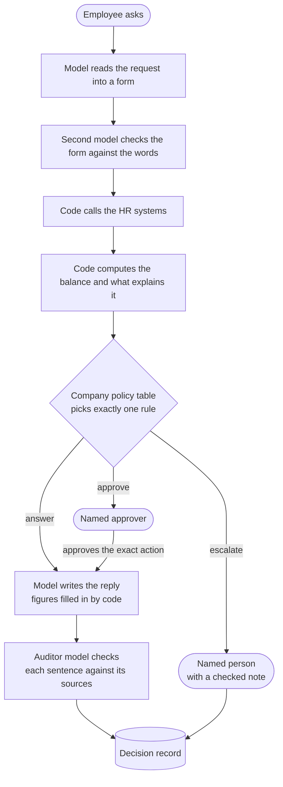

# HR case desk

An HR helpdesk that resolves two kinds of case on its own: leave balance questions and HR letter requests. It answers from the HR records, cites a source for every sentence, and hands everything else to a named person with the reason.

[](https://drruin.github.io/hr-case-desk)

**Walkthrough video (5 min):** [drruin.github.io/hr-case-desk](https://drruin.github.io/hr-case-desk), with chapters.

## How a case flows



Models read and write. Code computes and decides. The writer cannot type a digit, so a wrong balance never reaches the employee.

## Run it

You need [uv](https://docs.astral.sh/uv/), Node 22 and an OpenAI API key.

```bash
uv sync
cp .env.example .env              # then set OPENAI_API_KEY
cd ui && npm install && npm run build && cd ..
uv run uvicorn app.main:app --port 8500
```

Open http://127.0.0.1:8500 and press **New request**. The example buttons fill in a request for each path. The **Leave Balance Service** switch in the sidebar takes that system down so you can watch the desk fail safely.

```bash
uv run pytest                     # 52 tests on scripted models, no API calls
```

Tracing in Langfuse is optional. See [app/README.md](app/README.md#langfuse).

## Try these

| Company | Employee | Request | What the desk does |
|---|---|---|---|
| Nilgiri | Asha Rao | Shows 21.5 days but I've only taken 4 | Answers: 2 days await approval (L4) |
| Nilgiri | Rohan Das | My PL shows 37 days but I've only taken 8 | Hands over: three single days could each explain it (L2) |
| Nilgiri | Neha Kapoor | My PL balance shows 30.5 days | Hands over: one day was booked twice (L3) |
| Nilgiri | Arjun Malhotra | Why does my earned leave show 46 days? | Answers: 3 days lapsed above the 40 day cap (L4) |
| Nilgiri | Rohan Das | Paternity leave | Hands over: HR grants special leave (L8) |
| Nilgiri | Asha Rao | Visa letter | Waits for Priya Nair, the HR business partner, then issues it once (D5) |
| Nilgiri | Kiran Mehta | Any letter | Hands over: the employee has left (D2) |
| Coromandel | Farah Siddiqui | Visa letter | Issues it at once under Coromandel's own rule (D3) |

## Results

320 requests drawn from the two companies' records, run on the live model:

| Measure | Result |
|---|---|
| Right call, answer or hand over | 309 of 320 |
| Missed handovers | 0 of 232, at most 1.3% at 95% confidence |
| Handovers that were not needed | 11 of 88, mostly casual leave written as "CL" |
| Same rule as the label | 281 of 320 |

## Folders

| Folder | What is in it |
|---|---|
| [app/](app/README.md) | The desk: API, case flow, model steps, policy tables, settings |
| [data/](data/README.md) | Two generated companies and the evaluation set |
| [docs/](docs/README.md) | Architecture, decision log, AI usage notes |
| [tests/](tests/README.md) | What the tests guard and how they run |
| [ui/](ui/README.md) | The web page |

## Files at the root

| File | What it is |
|---|---|
| `pyproject.toml`, `uv.lock` | Python dependencies, pinned |
| `.python-version` | Python 3.13 |
| `.env.example` | Every setting with its default. Copy it to `.env` |
| `docker-compose.yml` | Self hosted Langfuse, optional |
