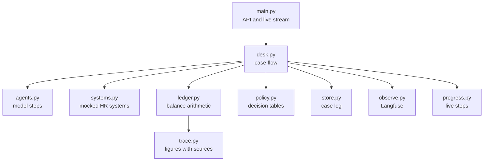
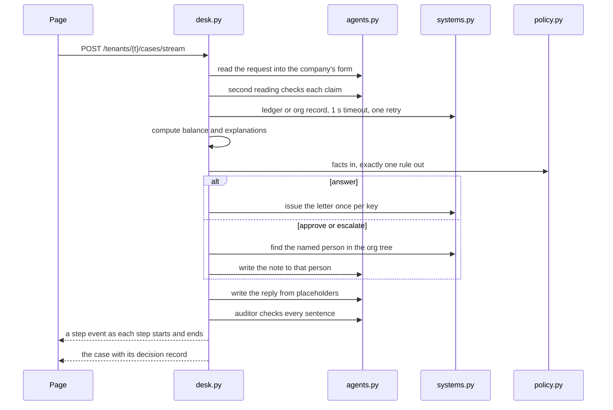

# app

The desk itself: a FastAPI service on Pydantic AI.

## Modules



| File | Job |
|---|---|
| `main.py` | Routes, the server sent event stream, serves the built page |
| `desk.py` | Runs a case: read, check, fetch, decide, act, write, audit, record |
| `agents.py` | The five model steps: reader, second reading, reply writer, handover note writer, auditor |
| `policy.py` | Loads each decision table, refuses one with a gap or overlap, picks the rule and explains it |
| `ledger.py` | Balance from ledger events, double bookings, the smallest set of events that explains a claim |
| `trace.py` | Numbers that carry the ids of the records they came from |
| `systems.py` | Leave Balance, Org Hierarchy and Document Repository mocks with timeout and retry |
| `store.py` | Append only case log, scoped to one company |
| `progress.py` | Steps of a running case for the stream and the record |
| `observe.py` | Langfuse traces, scores and the handover review queue |
| `config.py` | Settings |
| `synth.py` | Generates a company's people and ledger, see [data](../data/README.md) |
| `casebook.py` | Builds the evaluation set, see [data](../data/README.md) |
| `evals.py` | Runs the evaluation as a Langfuse experiment |

## One case



## API

| Route | What it does |
|---|---|
| `GET /tenants` | Companies and their people |
| `POST /tenants/{t}/cases` | Open a case, get the decision record |
| `POST /tenants/{t}/cases/stream` | Same, with live steps |
| `GET /tenants/{t}/cases` | Cases, newest first |
| `GET /tenants/{t}/cases/{id}` | One case |
| `POST /tenants/{t}/cases/{id}/review` | Approve or reject the exact action shown |
| `GET`, `PUT /faults` | Which HR systems hang, for the failure drill |

## Settings

Read from the environment or `.env`.

| Setting | Default | What it does |
|---|---|---|
| `OPENAI_API_KEY` | none | Key for the model steps |
| `MODEL` | `gpt-6-luna` | Model for every step |
| `OUTPUT_RETRIES` | 2 | Times a model may fix an output the checks reject |
| `TIMEOUT` | 1.0 | Seconds an HR system call may take |
| `RETRIES` | 1 | Extra attempts after a timeout |
| `FAULT_DELAY` | 5.0 | Seconds a system hangs in the drill |
| `DATA` | `data/` | One folder per company |
| `DATABASE` | `cases.sqlite` | Case log |
| `LANGFUSE_URL` | `http://127.0.0.1:3000` | Langfuse server |
| `LANGFUSE_PAUSE` | 60 | Seconds to skip Langfuse after it fails, so a case never waits on it |
| `CONFIDENCE` | 0.95 | Confidence of the evaluation's error bounds |
| `EVAL_CONCURRENCY` | 4 | Evaluation cases run at once |

## Langfuse

Optional. Each case becomes one trace with its model calls, scores and a review queue for handovers.

```bash
uv run python -m app.observe      # writes langfuse.env with generated keys, once
docker compose up -d              # Langfuse on http://127.0.0.1:3000
```

Sign in as `reviewer@case-desk.local` with `LANGFUSE_INIT_USER_PASSWORD` from `langfuse.env`. Run the evaluation with `uv run python -m app.evals`.
