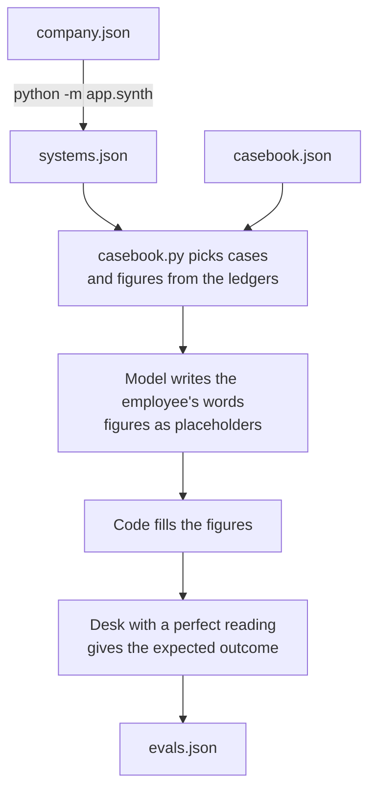

# data

Two made up companies, shaped on a real Indian leave policy with the names, wording and numbers changed.

| Company | People | Ledger entries | Carry forward cap | Visa letters |
|---|---|---|---|---|
| Nilgiri Analytics | 424 | 11,992 | 40 days | Need the HR business partner |
| Coromandel Freight | 182 | 4,842 | 30 days | Issued at once to the employee |

## Files

| File | What it holds |
|---|---|
| `<company>/policy.json` | Handbook clauses and the decision tables. Each table defines the request form, the columns with plain meanings, and the rules |
| `<company>/company.json` | What the generator needs: headcount, departments, leave rules, holidays, how often pending requests and double bookings occur, and the named people the demo uses |
| `<company>/systems.json` | Generated HR records: people, org chart, leave ledger, documents |
| `casebook.json` | How the evaluation set is drawn: case mix, writing styles, injection rate |
| `evals.json` | 320 labelled requests |
| `eval_results.json` | Expected and actual outcome per request from the last live run |

## How the data is made



The ledgers follow the leave rules: monthly accrual with a cutoff on the 15th for joiners and leavers, carry forward up to a cap with the rest lapsing on 1 January, approved and pending requests on working days, and separate privileged and casual balances. Generation is seeded, so the same `company.json` always gives the same `systems.json`. A test checks that.

```bash
uv run python -m app.synth        # rebuild both systems.json files
uv run python -m app.casebook     # rebuild evals.json, uses the model
```

## Changing a policy

Edit the company's `policy.json`. The desk refuses to start if a table has a gap or an overlap, or if a rule cites a clause the handbook lacks, and the error names the cell. Adding a letter kind is a table edit with no code change.
