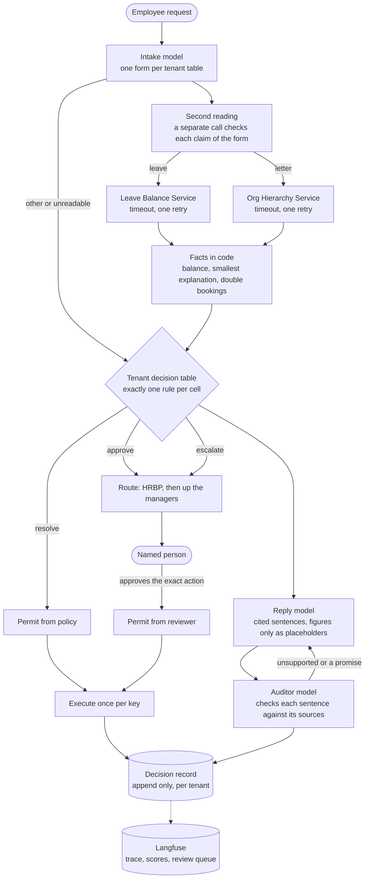
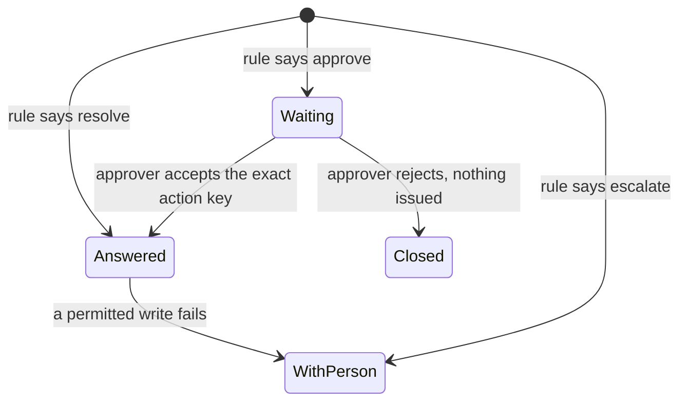

# Architecture note

## How a case flows

## Live steps

`POST /tenants/{tenant}/cases/stream` opens a case and answers with server sent events. Each step of the desk sends a `step` event when it starts and again when it ends: the reading, the second reading, every HR system call and its retries, the rule that fired, the letter, the handover and each rewrite the auditor asks for. A last `case` event carries the full case, or `refused` the reason. The steps travel in a context variable, so the calls that `asyncio.gather` runs side by side report into the same case. The record keeps the final state and timing of each step, and the case page shows them under **How it was decided**. The case runs as its own task, so a closed page does not stop it.

## Who decides what

| Step | Decided by | Why |
|---|---|---|
| What the employee asks | Intake model, one form per tenant table | Language is the model's job. Each form is built from the tenant's table, so the letter kinds it may choose are the ones the policy knows. Figures must come with the employee's exact words, checked in code |
| Leave balance and what explains the gap | Code | Arithmetic and search over ledger events. A model stating its own confidence is not evidence |
| Resolve, approve or escalate | Tenant decision table | Policy belongs to the tenant, versioned and checked at load |
| Who handles it | Code walking the org tree | First approver above the employee who is not the requester |
| Running a write | Permit holder | Only the policy table or the named reviewer can grant one |
| Whether the form matches the employee's words | Second reading model | A separate call rules yes, no or cannot tell on each claim. Anything but yes on all of them sends a letter to a person |
| Wording of the reply | Reply model | It may not type a number. Every figure is a placeholder filled from the traced facts, and every sentence names the sources it rests on |
| Why a person was brought in | Note model, from code written sources | When a case goes to a person, a second writer tells them why the desk stopped, what would have let it finish, and what the handover leaves to them. Code writes the handover and the would have finished sources, so the note can only restate facts. The auditor checks it like the reply |
| Whether each sentence is supported | Auditor model | It reads each sentence beside the full text of the sources it cites, and lists any promise the desk cannot keep. A failing sentence goes back to the writer. If the writer keeps failing, the reply is the rule's own words |

## Where a person enters

- **approve**: the case waits for the routed approver. The review must name the action key the approver was shown, so a person approves exactly what they saw. A second approval is refused, and a repeated execution returns the first result.
- **escalate**: the case goes to the routed person with the facts already gathered and the rule that stopped it.
- **the note**: whoever is brought in gets a short note, written by a model and checked sentence by sentence, on why the desk stopped and what is now theirs to decide. It cites two sources code writes for the handover: why this person has the case, with what the outcome leaves to them, and the smallest change that would have let the desk finish. The page shows it above the approval. If every draft fails the audit, the note is the rule's own words.
- **a write fails after a permit**: the case is marked failed and routed. Nothing is claimed as done.

## Sources and citations

The desk builds one source per piece of evidence before the reply is written: the employee's words, the second reading, each ledger event, the computed balance, the HR record of the person who handles the case, a system that did not answer, the issued document, and the rule with the plain reasons it applies. The writer may cite only these ids, and a placeholder brings the sources of its figure with it. The page renders each sentence with numbered citations. Clicking a number highlights its source.

## How explainability works

Every case writes one decision record. Code writes it, never a model. It holds:

1. What the desk saw: each system call with its time, attempts and a digest of the response, or the error.
2. What the table read: each input with its value, a plain detail and the source records behind it.
3. The rule that fired, with the table id and version and the rule's own words.
4. **Because**: the smallest set of inputs that forces this outcome. The desk removes inputs one at a time and keeps only those whose removal would let the outcome change.
5. **Would have resolved if**: the smallest set of inputs whose change leads to an automatic answer, with values that do.
6. Figures as equations over ledger events, for example `4 = 8 [G-1001] - 2 [T-1041] - 2 [P-1107]`.
7. What happened after: approvals, rejections, executions, each with who and when.
8. Each reply sentence with its citations and the auditor's verdict and reason.
9. For a case handed to a person, each sentence of the note to them, checked the same way.

The same reasons appear in plain words for the employee and the page: each input has a label and a meaning per value in the tenant's table, so "data = unavailable" reads "HR system answer: the HR system did not answer".

The table decides on the facts the desk could establish. When the Leave Balance Service is down, the only fact is that the data is unavailable, and the table must reach exactly one rule from that alone, or the case is refused as a configuration error. No placeholder values stand in for facts the desk does not have.

Both explanations are exact because every table is checked at load to have exactly one rule for every combination of inputs. Numbers are split at the bounds the rules use, so the check is finite. A table with a gap or an overlap does not load and the error names the cell.

## Tracing and evaluation

When Langfuse keys are set, each case is one trace: the model calls nest under it through Pydantic AI's OpenTelemetry instrumentation, and the desk scores the trace with who handled it, the rule, the share of supported sentences and the second reading. Every case handed to a person joins a review queue where a reviewer marks the handover needed or not, and approvals add a score. The evaluation runs as a Langfuse experiment over a labelled dataset, so its results sit next to the traces they came from.

## Part 2: what changed and what did not

The explainability requirement was read before the design, so the record is the architecture rather than an addition to it. Nothing in the flow changed for it.

- **Unchanged**: the decision path. The table already decides, and its rule id and version are the justification.
- **Added for auditors**: the two explanations and the traced figures, all computed from the table and the ledger, plus the page that shows them.
- **What a late requirement would have cost**: if the model had decided and a log had recorded its calls, explaining a decision would mean reading model output after the fact. That is a log dump, not a justification.
