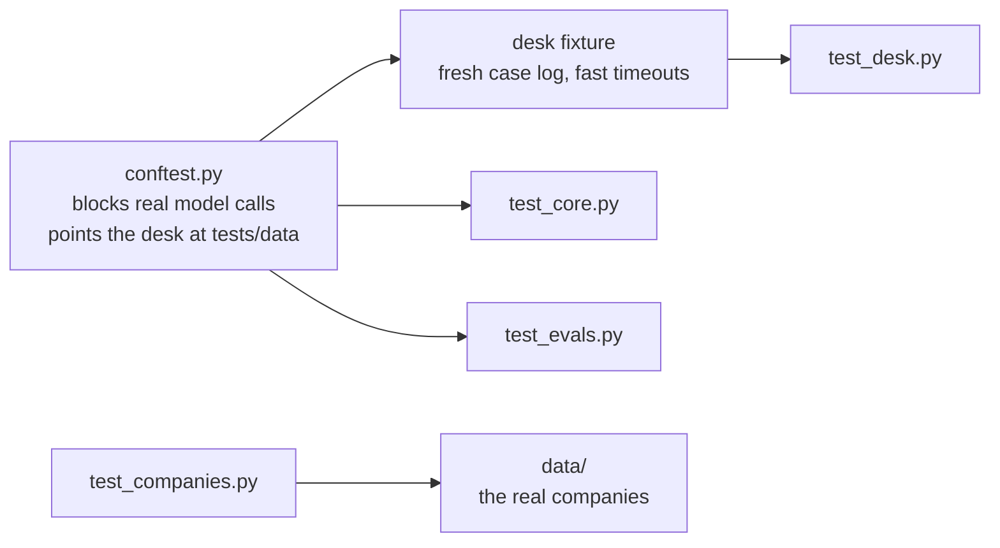

# tests

```bash
uv run pytest
```

52 tests. Every model is scripted with Pydantic AI's `FunctionModel`, so the suite makes no API calls and runs in seconds.



| File | What it does |
|---|---|
| `conftest.py` | Setup shared by every test. It turns off real model requests, turns off Langfuse, and points the desk at `tests/data`. Its `desk` fixture gives each test a desk with an empty case log in a temp folder, timeouts cut to 0.05 s so the failure drill runs fast, no hanging systems, and a scripted model |
| `test_core.py` | Table gap and overlap checks, minimal explanations, ledger arithmetic, the reply's placeholder and citation checks, a Langfuse outage |
| `test_desk.py` | Whole cases: answers, approvals bound to one key, letters issued once, handovers, the failure drill, tenant isolation, rewrites, the stream |
| `test_companies.py` | The served data matches what the generator builds, and each demo request reaches its rule and clause on the real companies in `data/` |
| `test_evals.py` | The exact error bound, and that every labelled request in `tests/data/evals.json` reaches a rule |

## data

Two small hand written companies, so the tests do not move when the generated data changes.

| File | What it holds |
|---|---|
| `acme/policy.json`, `globex/policy.json` | Decision tables. Acme answers gaps up to 5 days and needs approval for visa letters. Globex answers up to 2 days and issues them at once |
| `acme/systems.json`, `globex/systems.json` | A handful of people and ledger events chosen to hit every rule |
| `evals.json` | 38 labelled requests over Acme and Globex |
