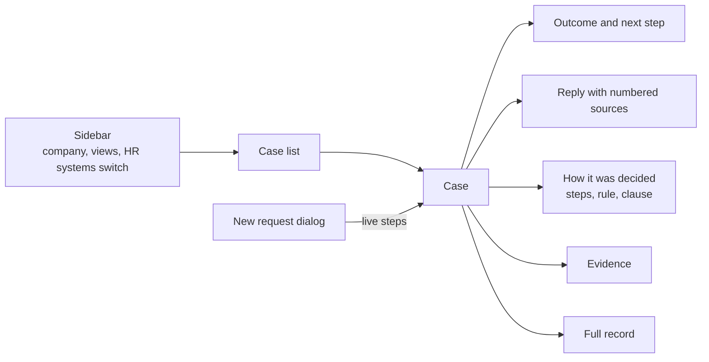

# ui

The web page: React 19, shadcn/ui, Tailwind and Motion, built by Vite into `../web`, which the API serves at `/`.

```bash
npm install
npm run build      # writes ../web
npm run dev        # hot reload on :5173, API calls go to :8500
```

## Page



| File | What it draws |
|---|---|
| `main.tsx` | Mounts the app |
| `App.tsx` | Layout, routing between overview and cases, keyboard shortcuts |
| `sidebar.tsx` | Company switcher, case views with counts, the outage switch |
| `overview.tsx` | Counts, share of reply sentences backed by sources, recent cases |
| `composer.tsx` | New request dialog with the people picker and example requests |
| `live.tsx` | Steps of a running case as they stream in |
| `case-view.tsx` | One case: outcome, note to the person, approval, the four tabs |
| `journey.tsx` | The six step pipeline replay |
| `palette.tsx` | Ctrl+K command menu |
| `status.tsx` | Status pill and colours for answered, waiting and with a person |
| `api.ts` | Typed API calls and the event stream reader |
| `index.css` | Tailwind theme, colours and fonts |
| `components/ui/` | shadcn components |

## Config files

| File | What it sets |
|---|---|
| `index.html` | Page shell Vite builds from |
| `vite.config.ts` | Build output to `../web`, the `@` import alias, the dev proxy to the API |
| `components.json` | shadcn settings for adding components |
| `tsconfig*.json` | TypeScript settings for the app and the Vite config |
| `eslint.config.js`, `.prettierrc`, `.prettierignore` | Lint and format rules |
| `package.json`, `package-lock.json` | Dependencies and scripts |

Shortcuts: C opens a new request, Ctrl+Enter sends it, J and K step through cases, Ctrl+K searches.
